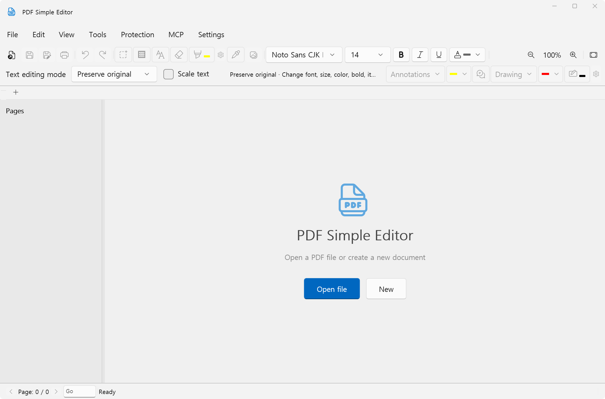

# PDF Simple Editor

A lightweight, powerful, and modern PDF editor built with **WinUI 3** and **.NET 10**. Powered by the **iText 9** engine, it provides a seamless experience for editing text, managing pages, and organizing PDF documents.



## 🚀 Features

### 📝 Precision Editing
- **Text Edit**
  - **Original Mode**: After activating the Select tool, click or drag to select, double-click to edit, and `Alt+Drag` to move.
    - `Ctrl+Enter` or right-click confirms, `Esc` cancels.
    - If an overlap warning appears, drag to select only the overlapping fragment and edit it.
    - Single-line selections expand to the right; multi-line selections wrap to the line below.
    - Select text or drag over a region, then use the toolbar to change its font, size, color, bold, or italic. Highlighted characters in inline editing can also be styled. Changes retain the surrounding PDF content and support undo/redo.
    - If the original font is not available, a fallback font is used instead.
  - **Replace Mode**: After activating the Select tool, click to select and drag to move.
    - `Ctrl+Enter` or right-click confirms, `Esc` cancels.
  - **Scale text**: uncheck to keep the font size and reflow text when narrowing or widening its area. Check it to scale text with its area.
- **Add Text**: Press `A` to switch to the Add Text tool, then add text with custom font family, size, color, bold, and italic. `Enter` inserts a line break, `Ctrl+Enter` confirms, and `Esc` cancels.
- **Fillable PDF forms**: Click a text field or checkbox in an AcroForm PDF to enter a value. Press `Enter` or click away to finish a text field, then use `Ctrl+S` or Save As to keep the form values in the PDF. For plain PDFs without form fields, use Add Text.
- **Selection & transforms**: The original selection icon selects text (`S`). The adjacent table icon selects graphics (`G`): table borders, lines, shapes, images, highlights, and signatures. Click or enclose objects with a drag, `Ctrl+Click` to select several, and `Delete` to remove them.
  - Use `Alt+Drag` to move graphics. Drag box handles to resize text, images, and graphics; corner handles preserve proportions when scaling.
  - Drag the round handle above a selection to rotate it; hold `Shift` for 15-degree increments. Changes to original text and graphics support undo/redo and preserve surrounding page content.
- **Images**: Insert images, save a selected image as a file, or extract all embedded images to a folder.
- **Region deletion (pdfSweep)**: Choose **Tools → Region deletion** or press `R`, then drag a rectangle to delete contents.

### 🖋️ Annotation & Highlighting
- **Smooth Highlighting**: Add semi-transparent highlights to text blocks.
- **Advanced Color Control**: Integrated color picker (eyedropper) and transparency sliders to customize highlight styles.
- **PDF Annotations**: The **Annotations** menu adds highlights, underlines, sticky notes and text boxes as standard PDF annotations; nearby settings control color, opacity and text-box font size.
- **Annotation Management**: Use **Select annotations** to pick annotations, then remove them with `Delete` or the context menu; **Delete all annotations in document** clears every page while keeping links, form fields and page content. Undo/redo applies.
- **Annotations / Bookmarks Sidebar**: The right sidebar groups annotations by page for selection, editing, deletion and sticky-note show/hide, and lists bookmarks hierarchically with hover tooltips and page navigation.
- **Bookmark Editing**: Use **Add current page** to add a bookmark and **Delete** to remove it with its children; changes are saved in the PDF with undo/redo.
- **Signature Tool**: Draw, customize, select, move, resize proportionally, edit, and save mouse-drawn signatures for reuse after reopening the PDF.
- **Drawing Tools**: Choose smooth Freehand, Line, Arrow, Triangle-head Arrow, Outline Arrow, Rectangle, Ellipse, or Polygon from the drawing menu. Drag to draw; for polygons, click vertices and double-click, press `Enter`, or click the first vertex to close. Press `Esc` to cancel. Set the color and stroke width beside the drawing menu. For rectangles, ellipses, and polygons, check **Fill** in the color settings to fill the interior with the selected color.

### 📂 Document Management
- **Multi-Tab Interface**: Work on multiple PDF files simultaneously using a modern tabbed layout.
- **Page Operations**: Select multiple pages with `Ctrl`/`Shift`, reorder them, delete unnecessary pages, or extract selected pages into a new PDF.
- **Merge & Split**: Combine multiple PDF files into one or split specific page ranges into new documents.
- **Images to PDF**: Select multiple PNG, JPEG, BMP, GIF, TIFF, or WebP images from **Tools → Images to PDF**. Each image becomes one A4 page, fitted without cropping, and the result opens in a new tab.
- **PDF to Image (PNG)**: Right-click a page → **Save page as image**, or export **All / Specified** pages (e.g. `1,3,5-8`) at 96/150/300/600 DPI via **Tools → PDF to Image**.
- **Page Thumbnails**: Navigate and manage pages quickly using the interactive sidebar and its right-click menu.

### 🛠️ Modern UX/UI
- **WinUI 3 & Windows App SDK**: Native look and feel with fluent design elements.
- **Drag & Drop**: Open files instantly by dragging them into the application.
- **Text Search**: Powerful search functionality to find specific phrases within the document.
- **Windows OCR**: Open **OCR → Recognize text (Windows OCR)**, choose an installed recognition language, and process the current page or all pages. OCR adds an invisible, embedded Unicode text layer for selection, copying and search; use Save or Save As to keep it in the PDF. Pages with existing text are skipped by default (clear the option for mixed text/scanned pages). Re-running OCR replaces this app's earlier OCR layer on the chosen pages. Install additional OCR languages in Windows Settings → Time & language → Language & region → Language options.
- **Korean / English UI**: The interface is fully localized in Korean and English.
- **Keyboard Shortcuts**:
  - `↑` / `Page Up`: Previous page
  - `↓` / `Page Down`: Next page
  - `S`: Switch to **Text Selection**
  - `G`: Switch to **Graphic Selection**
  - `A`: Switch to **Add Text Tool**
  - `R`: Switch to **Region Deletion**
  - `Ctrl+O`: Open File
  - `Ctrl+S`: Save File
  - `Ctrl+F`: Find Text

## MCP server

Run `PDFSimpleEditor.exe --mcp` to start a headless server using the standard
[MCP stdio transport](https://modelcontextprotocol.io/specification/2025-11-25/basic/transports).
The client launches the process and communicates using newline-delimited UTF-8
JSON-RPC on stdin/stdout. Normal execution still opens the editor. Closing stdin
ends the server; diagnostics use stderr only.

Open **MCP → MCP settings** to display and copy the standard configuration with
the current executable's absolute path. For example:

```json
{
  "mcpServers": {
    "pdf-simple-editor": {
      "command": "C:\\Apps\\PDFSimpleEditor.exe",
      "args": ["--mcp"]
    }
  }
}
```

The server exposes these tools through `tools/list`, including argument schemas:

| Tool | Function |
| --- | --- |
| `pdf_create` | Complete PDFs from plain text, structured flow blocks, positioned page elements or a JSON file |
| `pdf_create_help` | Agent authoring guide, working examples and the live JSON schema |
| `pdf_inspect` | Document revision, page sizes and editable objects; optional kind, region and count filters |
| `pdf_find_text` | Search editable text across all pages and return matching object IDs, page numbers and bounds |
| `pdf_read` | Read body text for one page, a page range or all pages; results remain separated by page |
| `pdf_vlm_ocr` | Return a page image for the calling agent's own VLM to recognize, with coordinate instructions and revision |
| `pdf_vlm_ocr_apply` | Save agent-recognized text and bounding boxes as a selectable/searchable invisible OCR layer |
| `pdf_add_text` | Unicode text with font, size, color, bold, italic and underline |
| `pdf_edit_text` | Replace, delete, move, scale, rotate, reflow and restyle original text |
| `pdf_add_graphic` | Rectangle, ellipse, line, polygon, freehand, highlight or image; rotation and opacity |
| `pdf_edit_graphic` | Move, resize, rotate, recolor paths, or replace a graphic/image/annotation |
| `pdf_delete_object` | Remove original text, graphics, images or annotations |
| `pdf_delete_objects` | Delete multiple inspected objects across pages using the same source revision |
| `pdf_batch` | Apply multiple edits, additions, redactions, form and page operations to one PDF atomically |
| `pdf_redact_region` | Remove intersecting content and form widgets using pdfSweep |
| `pdf_manage_pages` | Insert, delete, reorder, rotate and crop pages |
| `pdf_set_form_fields` | Fill named AcroForm fields, including Korean text and checkboxes |
| `pdf_merge` | Merge PDFs in the supplied order |
| `pdf_extract_pages` | Extract/split pages in the supplied order |
| `pdf_to_images` | Render whole pages as PNG; select ranges and 72–600 DPI |
| `pdf_extract_images` | Extract embedded raster images, including nested images |
| `images_to_pdf` | Fit each supplied image onto one A4 PDF page |

## 🛠️ Technology Stack
- **Framework**: .NET 10.0
- **UI Framework**: WinUI 3 (Windows App SDK)
- **PDF Engine**: iText 9.8.0 (Core, BouncyCastle), pdfSweep 5.0.8; Windows.Data.Pdf for page rendering.
- **Language**: C#

## ⚙️ Installation

### 📥 Download
You can download the latest version from the [Releases Page](https://github.com/kirinonakar/PDF_simple_edit/releases).

### Prerequisites
- Windows 10/11 (version 19041 or higher)
- [.NET 10 SDK](https://dotnet.microsoft.com/download)

### Build from Source
1. Clone the repository:
   ```bash
   git clone https://github.com/kirinonakar/PDF_simple_edit.git
   ```
2. Open the solution in Visual Studio 2022 (or later).
3. Restore NuGet packages.
4. Build and run the `PDF_simple_edit` project.

## 📄 License
This project is licensed under the GNU Affero General Public License v3.0 - see the [LICENSE](LICENSE) file for details.
